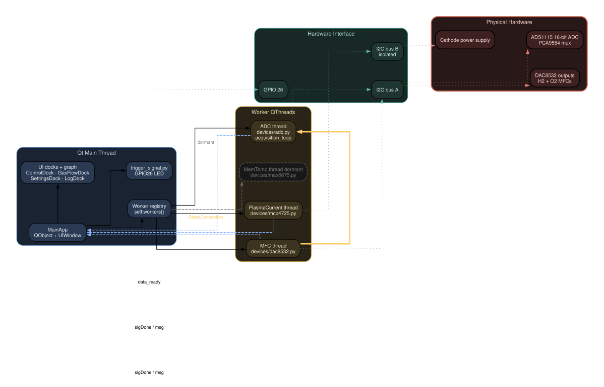
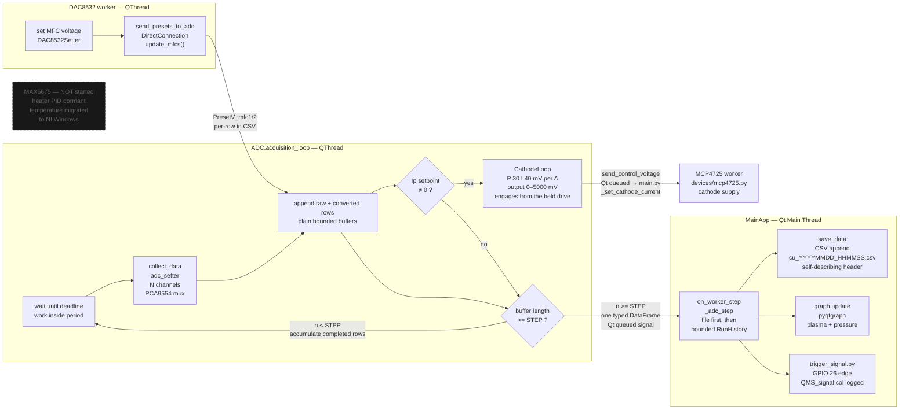

# Qt Threading Architecture

The threading model is the deepest stratum in the codebase — a six-phase
story from a template-copied monolith to a proper per-device worker hierarchy.
Three diagrams follow; the historical narrative is below them.

---

## 1 · Runtime ownership

Who owns what, and in which thread it executes.

{ .architecture-diagram }

??? note "Diagram source (Graphviz)"
    This diagram is rendered from Graphviz DOT rather than Mermaid. Mermaid + Dagre
    produced unstable edge routing and stretched subgraphs in MkDocs Material; Graphviz
    gives a fixed left-to-right layout that stays consistent across builds.

    Edit `docs/assets/graphviz/runtime_architecture.dot`, then regenerate:

    ```bash
    python scripts/build_graphviz.py
    ```

Edge key: **solid** = ownership · **dashed** = Qt queued signals or dormant registry link · **bold** = DirectConnection · **dotted** = hardware bus links

Key structural notes:

- `MainApp` uses multiple inheritance (`QObject + UIWindow`) — a pattern inherited
  from `echelle_spectra`. `UIWindow` is a mixin in `mainView.py` that keeps layout
  code separate while sharing `self.*` attribute space.
- Worker threads are stored in `self.workers[name]["worker"]` / `["thread"]`.
  `MainApp` owns all `QThread` lifetimes.
- The MCP4725 sits on a **separate, galvanically isolated I²C bus** since April 2026
  — plasma transients on bus A were corrupting the ADC and DAC8532.
- The `MAX6675` / heater path is instantiated in code but its entry in
  `define_devices` is commented out. The code is dormant, not deleted.

---

## 2 · Acquisition data flow

The ownership diagram above covers the core Qt workers. From 4.15.0 an
optional `KikusuiLogger`, owned separately by `MainApp._kikusui_logger`,
runs in a Python thread alongside them. It owns its read-only TCP socket
and separate run CSV; its only input from the application is a copy of the
locked `RigStatus` setpoints. Messages cross to the main thread through
`kikusui_message`, a queued Qt signal. It never touches a widget or a hardware
worker. ADC delivery does not wait for LAN reads, and telemetry continues
through an ADC retry. The hardware workers and GPIO shut down before the
main thread interrupts and joins this optional recorder. Socket deadlines
and interruptible waits bound its shutdown; a recorder that has not stopped
blocks a second telemetry start rather than overlapping files/connections.

The ADC thread follows monotonic sampling deadlines. Below one second it
records one scan per period; at one second and above it averages raw scans
through each window. `STEP` only batches completed rows for delivery to the
GUI thread for CSV logging and plotting. Timing summaries distinguish read,
processing and delivery costs; see the [timing investigation](../diagnostics/2026-09-10-adc-timing-optimization.md).
The routine summary leaves the reader on `send_routine` and is kept in
`controlunit.log` and the web view's Log but not on the Qt Log panel; an
overrun leaves on `send_message` and reaches all three. The panel is
appended to, never rebuilt, and keeps its newest `LOG_PANEL_LINES` (4.29.1:
rebuilding it held the interpreter, and so the reader, for longer at every
line as the run went on).

Every Start builds fresh workers, and `_apply_screen_settings` gives them
what the screen shows before their threads start: each gauge's mode and
range, and the Settings dock's sampling time. Outputs are not carried over:
gas, the cathode drive, the PID and the supply's output start at zero and off.

The same three settings also outlive the program. Each gauge's mode (Torr,
Pa or Off) and range, and the sampling time the run uses, are written to
`~/.controlunit/screen.json` (`controlunit/screen_memory.py`; the folder is
`settings_home()`, beside `operators.json` and `fence.txt`, never in git)
whenever one of them changes, from the dock or a browser, and at every
Start. At launch, once the window is built and before anybody can press
Start, `_restore_screen` puts them back into the selectors and the combo,
so the first Start's `_apply_screen_settings` carries them into the first
run, and says once in the Log what it restored ("Restored from the last
run: Pd Torr 1e-7, Pu2 off, sampling 10 s"). A missing, unreadable or
invalid file leaves settings.yml's values, with one Log line saying so;
nothing about it can keep the window from opening. Before the file, a
restart came back at settings.yml's Torr, 1e-3 and 0.1 s: on 2026-11-11 Pd
read 1.5e-3 Torr for 18 s when the vessel was at about 1.5e-7, and Pu2
lost its "declared off". Outputs are never kept there.

A gauge press on the rig's own dock is logged in the browser's words for
the same setting ("Pd range -7", "Pu2 declared off"); restoring at launch,
the Start-time push, a browser's command (which logs its own "Remote: …"
line) and the Diagram's word (below, which logs its own) are not.

The ion gauges follow the PIHTI Diagram's on and off
(`controlunit/diagram_follower.py`; queezz, 2026-11-13: "Why should we turn
that off twice??"). The asking runs on a Python daemon thread of its own,
`diagram-follower`, started at the end of `MainApp.__init__` when a gauge in
`settings.yml` names a `Diagram Element` and the neighbours file gives the
Diagram an address. Every 10 s it asks the Diagram's `/elements-state` with
a 2 s timeout and keeps only the newest answer behind a lock; it never
touches Qt, a worker or the ADC, and the reader never waits on it. The main
thread takes that answer on `diagram_timer`, a 3 s `QTimer`, and acts only
on a gauge whose word changed since the last answer: it moves the dock's
mode selector inside `_moving_selectors("diagram")`, so the selector's own
signal tells the worker, the web status and `screen.json`, exactly as a
browser's gauge command does. Silence or an answer that is not the states
changes nothing, with one Log line when following stops and one when it
resumes. Dummy hardware asks only a Diagram on its own loopback.

The same timer settles the checks of a recorded switch against the gauge's
own raw volts ("When the diagram says the gauge is off, but the signal
doesn't change, we should warn"). They read the raw column of the window's
own `RunHistory` (`self.datadict["ADC"]`) on the main thread, never the
ADC; a switch is held only while a run records, and Stop drops a pending
one with the run that would have answered it.

The Raspberry Pi's own health is read on a third Python daemon thread,
`pi-health` (`controlunit/pi_health.py`, 2026-11-13): every five minutes
`vcgencmd get_throttled` (the under-voltage, frequency-capped, throttled
and soft-temperature-limit bits, now and since boot), the core temperature
from `/sys/class/thermal/thermal_zone0/temp`, and `shutil.disk_usage` of
the data folder. The I²C reads have failed during plasma, and a sagging Pi
supply would fail them the same way; the one look at the supply, on
2026-09-09, was by hand. Off the Pi there is no `vcgencmd` and no thermal
zone, which reads as "not available" and is never a failure. The thread
never touches Qt, a worker or the ADC: each reading and the Log sentences it
makes cross to the main thread on `pi_health_report`, a queued Qt signal,
as the Kikusui recorder's messages do, and the main thread writes the Log
and the web record's `pi`. It is started from `main` beside the web view
(`start_beside`), not from `MainApp.__init__`, so a test that builds a
window starts no thread it did not ask for.

`_adc_step` also watches each delivered batch for plasma current read with
the filament off (`controlunit/filament_off.py`; queezz, 2026-11-13: "if we
see the current with the filament power off, it's a SUS"), on the main
thread, after the rows are written, from the batch's own `PresetV_cathode`,
`Ip_c` and `date` columns and the Kikusui snapshot this thread already
holds. It never reads the ADC and never drives anything; see
[Cathode control](../hardware/cathode-control.md#ip-with-the-filament-off).



Batching amortises signal and main-thread costs; it does not average rows.
Averaging is governed independently by `AVERAGE_FROM_SECONDS` (1 s) and
`INNER_SECONDS` (0.2 s). Completed buffered rows are emitted when the worker
stops; interrupted scans and partial averaging windows are discarded.

```python
# controlunit/devices/device.py
def set_sampling_time(self, sampling_time):
    if sampling_time >= 0.9:  self.STEP = 1
    if sampling_time < 0.9:   self.STEP = 3
    if sampling_time < 0.1:   self.STEP = 5
```

The `send_presets_to_adc` worker→worker signal uses `DirectConnection` (runs
in the emitter's thread) rather than the default queued connection, because
`update_mfcs` only writes to `self._mfc_presets` — a plain dict that never
touches Qt internals.

---

## 3 · Shutdown and safety sequence

Hardware safety is the primary concern: DAC outputs must reach zero *before*
threads die. The pattern is idempotent — `turn_off_voltages` can be called
multiple times safely, including when `self.workers` is empty.

```mermaid
sequenceDiagram
    actor User
    participant App as MainApp
    participant ADC as ADC Worker
    participant PC as MCP4725 Worker
    participant MFCs as DAC8532 Worker
    participant HW as Hardware DACs

    User->>App: Stop, the window closed, or a signal
    App->>App: stop_acquisition() → abort_all_threads()

    rect rgb(40, 30, 10)
        Note over App,HW: turn_off_voltages() — hardware first
        Note over App: guard: if not self.workers → return early
        App->>ADC: set_plasma_current.emit(0)
        ADC->>HW: PID setpoint → 0
        App->>PC: output_voltage_signal.emit(0)
        PC->>HW: MCP4725 → 0 mV
        App->>App: _mfc_presets = {1: 0, 2: 0}
        App->>MFCs: output_voltage_signal.emit(1, 0)
        App->>MFCs: output_voltage_signal.emit(2, 0)
        MFCs->>HW: DAC8532 ch1 + ch2 → 0 V
        Note over HW: all DAC outputs at zero — plasma and MFCs off
    end

    rect rgb(10, 25, 40)
        Note over App,MFCs: thread teardown
        loop each worker in self.workers
            App->>ADC: worker.running = False
            App->>MFCs: worker.running = False
            App->>PC: worker.running = False
        end
        App->>ADC: thread.quit() · thread.wait()
        App->>MFCs: thread.quit() · thread.wait()
        App->>PC: thread.quit() · thread.wait()
    end

    Note over App: self.workers cleared — safe to call again
```



This sequence is the product of being bitten: `_mfc_presets` is zeroed in
multiple places, and `turn_off_voltages` is callable any time including before
workers are started. The hardware stop always precedes the software stop.

The Diagram follower and the Pi's health monitor are the program's, not a
run's: Stop and Start leave them running. They stop in `_closing`, the one
slot on `QApplication.aboutToQuit`, after the hardware: `_closing` first
stops a run still going (Stop's own `stop_acquisition`, so the outputs are
zeroed and the workers joined), then `_stop_diagram_follower` (stops
`diagram_timer`, sets the follower's stop event, joins its thread for at
most half a second) and `_stop_pi_health` (the same, for `pi-health`).
Neither holds a device, file or open socket between asks, so nothing in the
hardware-first order waits on them; a thread still inside its one request,
or its one `vcgencmd`, is a daemon and ends with the interpreter. Last,
`_closing` writes why the program is ending, so that is the Log's last line.

### How the program ends, and says why

On 2026-11-11 at 16:47 the program restarted with no reason anywhere. Every
way it ends now writes `Program closing: <why>` as the Log's last line, with
"; the run was stopped first, outputs to zero" when it was ending under a
run:

| What ended it | The reason in the line | Exit status |
| --- | --- | --- |
| The Quit button (disabled while a run records) | the Quit button was pressed | 0 |
| The window closed (`lastWindowClosed`) | the window was closed | 0 |
| SIGTERM (`kill`, a service manager, a shutdown) | SIGTERM, asked to stop by another program (…) | 143 |
| SIGHUP (the terminal it runs from closed) | SIGHUP, the terminal it ran from was closed, or its session ended | 129 |
| SIGINT (Ctrl+C) | SIGINT, Ctrl+C in the terminal it ran from | 130 |

An exception no code caught is not in the table: it no longer ends the
program (below).

The window's own close used to end the program with the workers running
and the DACs holding, although the sequence above was drawn for it; it now
stops the run in `_closing` before anything else.

A signal goes through Stop's path, hardware first, and never runs it inside
the handler. Python runs a signal handler only between two of its own
bytecodes, which may be halfway through any slot, and Qt's event loop is
C++. So `install_stop_handlers` (called from `main` only) gives SIGTERM,
SIGHUP and SIGINT a handler that only notes the signal
(`MainApp._signal_received`), and a 250 ms `QTimer` whose slot,
`_take_pending_stop`, acts on it inside the event loop and is also what
lets the interpreter look at a signal at all while the window is idle. It
calls `shut_down`: the run is stopped exactly as Stop stops it (the screen's
switch set to match, `stop_acquisition`, so `turn_off_voltages` and the
workers' own aborts zero every DAC before their threads are joined), then
`app.exit(128 + signal)`, then `aboutToQuit` and `_closing` as above. A
second signal while ending changes nothing. Before this, SIGTERM and SIGHUP
killed the process where it stood, with the DACs holding whatever they held.

Except that, once `shut_down` has begun, SIGTERM and SIGINT are given back
their default disposition (`_let_a_signal_end_it`), so a second `kill` or
Ctrl+C ends the process at once. A shutdown that hangs, a worker's
`thread.wait()` behind an I²C call that never returns, runs no event loop,
and a signal its handler only noted would never be acted on: only SIGKILL
would end it. SIGHUP keeps its handler, because a closing terminal may send
it again while the shutdown the first one started is still zeroing the
outputs.

Once it starts to end, the program's stdout and stderr lose what they
cannot write instead of raising (`_LosingStream`). After SIGHUP every write
to the closed terminal raises, and the DAC8532 worker prints each voltage
after setting it: without this, the shutdown stopped at its first line, gas
line 1 at zero and line 2 never reached.

`sys.excepthook` is replaced in the same place. PyQt5 aborts the process
(`qFatal`) on an exception that escapes a slot unless a hook is installed,
and carries on when one is. An abort leaves the DACs holding what they held
with nothing recording (the 2026-08-19 plasma); 4.30.0 ended the program
through Stop instead, which zeroes a discharge somebody is running because
some convenience broke. The hook now follows queezz's standing ruling for a
dead reader, "Hold and alarm!" (owner decision 2026-09-07): the outputs stay
where they were, the slot that raised has ended, the program carries on,
and the Log says so. On the main thread it writes `Uncaught error: <the
traceback's last line> (in <function>, <file> line <n>); outputs held, the
program carries on`, red, and hands the exception to the hook that was
there before, which prints the whole traceback to stderr. A hardware
worker's slot runs on its own `QThread`, and PyQt calls the hook there,
where the Log must not be written: the line, `Uncaught error on <thread>:
…; outputs held`, crosses to the main thread on `uncaught_elsewhere`, a
queued signal, as the Kikusui recorder's messages do. The same error from
the same place is said, and printed, once a minute
(`UNCAUGHT_REPEAT_SECONDS`), the next line counting the ones held back, so
a timer's slot that raises at every tick is not a line every tick. An
exception on a plain Python thread is left to `threading.excepthook`.

`scripts/run_controlunit.sh` no longer `exec`s the program: it waits for it
and appends `# <date> exited with status N` to the stderr file, after the
`# <date> started` it always wrote. The launcher traps HUP, TERM and INT
only so it outlives the program long enough to write that line (a trap is
reset in the program, which handles its own), and its `tee` ignores them,
so the program's last words still reach the file when the terminal closes.

`thread.wait()` lasts as long as the worker takes to notice its abort flag.
The ADC and thermocouple loops used to sleep one whole sampling period
between steps and look at the flag only afterwards, so at the rig's
ten-second sampling the quit button came back ten seconds after Stop (owner
report 2026-09-07). A worker now sleeps through `DeviceThread.pause`, which
looks at the flag every tenth of a second (`sleep_unless_aborted` in
`devices/device.py`), and a sleeping worker notices Stop within that. A hardware read can take
longer: the ADC checks abort between channels, but a blocked kernel I²C call
cannot be interrupted by the Python polling deadline.

> *"Haha — yes, guilty. It may still be somewhere in the Qt signals."* — Arseniy

---

## Six phases of threading evolution

### Phase 0 — The Echelle template (pre-2020)

The `Worker(QtCore.QObject)` shape, the `ThreadType` enum dispatch, the
`STEP`-batched numpy buffers, the `app.processEvents()` from inside the
worker, and the `sys.path.append` package hack were all **ported from
`echelle_spectra`** — Arseniy's earlier spectrograph-control application.
Ito-kun did not invent this shape; he extended it.

The `_echelle_base` variable in `controlunit/__init__.py` is a literal
fossil — the variable name was never changed after the copy.

### Phase 1 — Monolithic worker (Feb 2020)

Initial commit: one `Worker(QtCore.QObject)` class for all devices,
dispatched by a `ThreadType` enum. Methods named `__plotPresCur` and
`__plotT`. Buffers are fixed-shape numpy arrays of `STEP` rows.

**Ito-kun's extension** (B4 student) introduced two patterns that became
technical debt:

1. A fresh I²C connection opened **on every channel read** — hurt acquisition
   throughput badly on a multi-channel scan.
2. Device behaviour dispatched by `ThreadType` enum, not by separate objects
   — impossible to trace which code path talked to which physical device.

### Phase 1.5 — Untangling (Mar 2020)

Commit `ed7cadb`: +161/−107 in `worker.py`. Renames `ThreadType` → `Signals`,
factors `read_settings()` out of every constructor, renames methods to
`readADC` / `readT`. Threading topology unchanged; vocabulary becomes
consistent.

### Phase 2 — Package + pdoc3 docs (Jun 2022)

Commit `4b7dcdc`: files moved into `controlunit/` directory. No structural
change. pdoc3 generates HTML for the then-current shape. That snapshot is
archived under `archive/pdoc3/`.

### Phase 3 — ADC tuning storm (May 2023)

Eight commits rewrite the acquisition loop to read from `AdcChannelProps`
populated from `settings.yml` instead of hard-coded constants. Numpy arrays
replaced with pandas DataFrames. `STEP` batching clarified.

The historical batching code accumulated samples between worker and GUI
updates. Current `STEP` batching and per-period averaging are independent;
see the acquisition data flow above.

### Phase 4 — Worker superclass split (Aug 2024)

Commit `5326e50`: 662 lines deleted from `controlunit/worker.py`, replaced
with `sensors/{worker.py, worker_adc.py, worker_dac8532.py, …}`. Committed
by Miura-kun directly from the lab Raspberry Pi (`pi <hasuo_kuzmin.lab@…>`).

> *"When Miura-kun was here I thought about transitioning to pandas for sanity.
> I finally got what classes are: basically a box, a drawer. So you don't spill
> and lose your functions."* — Arseniy

Phase 4.5 (Sep 2024): 10-day burst of renames — `sensors/` → `devices/`,
`components/` → `ui/`, terminology unified. Behaviour untouched; vocabulary
became consistent.

### Phase 5 — Codex PRs (Aug 2025)

Two LLM-authored PRs (#20, #21):

- Moved `update_processed_signals_dataframe` out of `main.py` into workers.
- Cleaned the (still-unused) `core_logic.py` stub.

These were **not tested on hardware** at merge time. The developer considered
the Codex PR workflow an experiment, and moved to Cursor + direct on-rig
testing afterward.

### Phase 6 — Isolation hardware push (Apr 2026)

Commits `0b417cf` and `dfbc65c`: galvanic I²C isolation for the MCP4725
plasma-current DAC. Kawabata-kun's plasma PID work landed alongside.

The isolation was critical: plasma transients on the cathode bus were
affecting the rest of the I²C tree.

> *"Kawabata-kun did the final plasma current PID loop. I made and tested
> one before isolation. Isolation was critical, of course."* — Arseniy

---

## The `UIWindow` multiple-inheritance idiom

```python
class MainApp(QtCore.QObject, UIWindow):
    ...
```

Unusual for Qt code. Inherited from `echelle_spectra`. Keeps layout code in
`mainView.py` physically separated from controller code without giving up
direct attribute access (`self.control_dock`, `self.graph`, etc.).

## Worker→worker signalling

```python
# controlunit/main.py
def start_cross_connections(self):
    mfcs_worker.send_presets_to_adc.connect(
        adc_worker.update_mfcs, type=QtCore.Qt.DirectConnection
    )
```

The DAC8532 worker tells the ADC worker what voltage it just set, so the ADC
can log the *commanded* preset alongside the *measured* signal.
`DirectConnection` runs the slot in the emitter's thread — correct because
`update_mfcs` only touches `self._mfc_presets`.
