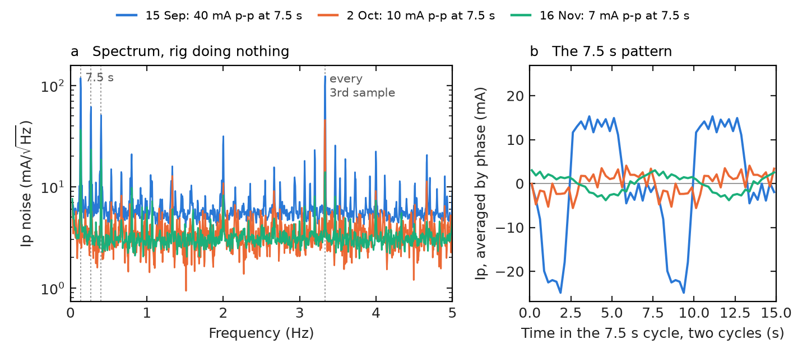

# The rig doing nothing: noise on every channel

Written 2026-11-18, while the rig stood idle during a lab meeting (queezz:
"No one's using it, you can do something while we are idle"). This is the
noise study he asked for on 2026-09-15: "one of these times one should look
at our signals when doing nothing and identify the noise. So we might
filter it better. And know the noise from signal."

It also answers the question the [Hall sensor noise page](2026-09-19-hall-sensor-noise.md)
left open: "After the hardware change, ten quiet minutes at 10 Hz show which
patterns survive." queezz changed the Hall sensor's supply on 2026-11-11,
fitting a small breakout board with XH connectors that splits the 5 V from
the Meanwell supply.

No setting on the rig was changed for this study. The record already
existed.

## The record

`cu_20261116_173717.csv`, from the git-ignored `data/rig/2026-11-16/`. Its
SHA-256 begins `77b7773dd5432657`. The analysis scripts are beside it in
`analysis/`.

- **Window.** 17:37:17 to 18:30:54 at 0.1 s: 32,135 rows, 9.9916 Hz (the
  mean interval is 0.10008 s, with 1 % of intervals under 0.083 s, 1 % over
  0.119 s, and a longest gap of 0.39 s). At 18:30:54 the sampling was set
  to 10 s.
- **Settings.** Every setter held still: no gas commanded, a cathode drive
  of 0 mV, and no QMS sync. Pu2 was declared off until 18:25:51, so its
  converted column is empty there and its raw voltage remains.
- **The source, from the journal of 2026-11-16.**
  - 16:27: the source was repaired and reinstalled.
  - 17:07: a hydrogen plasma test, "kept for 15 minutes". It ended before
    this file began.
  - 18:02: a helium leak check.
  - 18:28: "temperature control works".

  There was no plasma in the window. The Kikusui's output was off
  throughout, and the supply itself was switched off at 17:59:46.
- **Two segments.**
  - **A, 17:38–17:59** (12,591 rows): the supply on, its output off.
  - **B, 18:05–18:25** (11,992 rows): the supply off. The pressures move
    with the leak check and the pumping, so pressure noise is taken from A
    only.

For the comparison in the figure, two older records were used:
- **September.** `cu_20260915_170626.csv`, 17:07–18:24: a filament
  conditioning, with no gas and no plasma. September files are not
  measurements of the plasma or the supplies (AGENTS.md, ruling of
  2026-10-02). It appears here only as the "before" of a sensor channel
  with nothing flowing through it.
- **October.** `cu_20261002_170146.csv`, 17:02–17:11, with the supply off.

## Every channel, segment A

**Noise** is the standard deviation after removing drifts slower than two
minutes. The **white part** is the standard deviation of successive
differences divided by √2. The **7.5 s line** is the peak amplitude at
0.13317 Hz. **Every third sample** is the peak-to-peak of the mean by
sample number modulo 3.

| Channel | Mean | Noise | White part | 7.5 s line | Every third sample |
| --- | --- | --- | --- | --- | --- |
| Ip, converted | −16.8 mA | 8.6 mA | 7.4 mA | 4.1 mA | 3.1 mA |
| Ip, at the ADC | 2.4653 V | 2.58 mV | 1.60 mV | 1.8 mV | 0.91 mV |
| Vhall | 4.9762 V | 2.86 mV | 1.71 mV | 2.1 mV | 0.60 mV |
| Pu (1.25e-5 Torr) | 3.8431 V | 0.29 mV | 0.27 mV | 7 µV | 9 µV |
| Pd (4.5e-7 Torr, pumping down) | 0.451 V | 2.1 mV, slow | 0.19 mV | 29 µV | 4 µV |
| Pu2 (controller declared off) | 0.09 mV | 0.36 mV | 0.26 mV | 4 µV | 9 µV |
| Bu (2.22 mTorr) | 22.2 mV | 0.165 mV | 0.143 mV | 1 µV | 6 µV |
| Bd (unplugged since 10-26) | −0.30 mV | 0.057 mV | 0.054 mV | 3 µV | 3 µV |
| MFC1, nothing commanded | −161 mV | 0.74 mV | 0.74 mV | 13 µV | 14 µV |
| MFC2, nothing commanded | 2.4 mV | 2.3 mV | 2.3 mV | 34 µV | 45 µV |
| Ci | −0.26 mV | 0.039 mV | 0.039 mV | 3 µV | 1 µV |
| Cv | −0.27 mV | 0.039 mV | 0.039 mV | 4 µV | 1 µV |

In segment B the electrical channels read the same to within 10 %. The
exception is the 7.5 s line on Ip and Vhall, which is about 40 % smaller
there (below).

## What it says

**Both Ip patterns survived the breakout, smaller.**
- **The 7.5 s pattern:** 40 mA peak to peak on September 15, 10 mA on
  October 2, and 7 mA now over the whole window (9 mA in A, 6.5 mA in B).
- **The every-third-sample pattern** (the main thread's batches of three):
  about ±12 mA in September, and 3.1 mA peak to peak now in A (2.0 mA in B).
- **Total:** Ip noise with the rig doing nothing went from 22.9 mA to
  9.7 mA to 8.6 mA.

**The patterns are on the Hall sensor's 5 V, not in the ADC.** Vhall, the
supply as the ADC reads it, carries both patterns: 2.1 mV peak at 7.5 s.
If the ADC's own reference moved by that much, Pu at 3.8 V on the same
board would move by about 1.6 mV; it moves by 7 µV. No channel other than
Ip and Vhall carries more than about 40 µV of either pattern.

**Dividing by Vhall removes about half of the pattern.**
- **The 7.5 s line:** Ip moves by 0.88 to 0.91 of what Vhall moves, in
  phase. A sensor whose output is a fixed fraction of its supply would move
  by 0.50 at zero current, so the conversion's division cancels only that
  0.50 share.
- **Broadband:** Ip follows Vhall with a slope of 0.70 (correlation 0.78
  to 0.80).
- **Fitting the share instead:** subtracting the best-fitting share of
  Vhall in place of dividing would lower the noise from 8.6 to 8.1 mA.
  That is not worth a change to what is recorded.

What remains, about 1.6 mV at the ADC (8 mA), does not follow the supply.
It is the sensor's own noise, forty times the ADC's floor (0.039 mV on Ci
and Cv).

**The 7.5 s line on the supply shrank between A and B**, from 2.1 to
1.3 mV on Vhall. Between the two segments the Kikusui was switched off and
the helium leak check began, so this record cannot say which change did
it.

**The zero.** With no current, Ip reads −17 mA: −16.8 mA in A and
−17.5 mA in B, so the supply on or off makes no difference. The quiet ratio
Ip/Vhall is 0.49542, against the conversion's midpoint of 0.4961. The Zero
Ip button takes this away on the screen, and the file keeps the raw
values.

**Single readings about 55 mA low.** 86 of 28,177 readings in the window
(0.3 %) sit more than 50 mA from zero, every one of them below. They are
single readings, or two together, roughly every twenty seconds (the median
gap is 22.5 s), and none shows on Vhall. That is a read glitch, not
current. A 5-point median removes them: through it, quiet Ip at 10 Hz stays
within 42 mA zeroed and 57 mA un-zeroed. Those numbers set the Live tab's
floor of 60 mA (4.32.0). The noise figures above include the glitches.

**Nothing is shared through the I²C reads.** Between the channels'
detrended residuals, every correlation is below 0.1 except two:
- **Ip and Vhall, 0.78:** above.
- **Pu2 and Bd, 0.29:** two inputs with nothing behind them, since Pu2's
  controller was off and Bd is unplugged. They pick up the same thing.

**The pressure channels need no filter at 10 Hz.** Their noise is 0.01 to
0.1 % of what they read. The Pd column moves slowly because the chamber was
still pumping down after the discharge, not because of noise. MFC1 reads
−161 mV with nothing commanded: that is the controller's own zero, not
noise.

## Filters on Ip, then and now

The filters run causally, as they would run live. The notches are the
September page's: second-order, Q 100, at 1/7.5 s and its second and
third harmonics.

| Filter on Ip | 15 Sep | 16 Nov, A | 16 Nov, B | Delay |
| --- | --- | --- | --- | --- |
| none | 22.9 mA | 8.6 mA | 8.6 mA | — |
| 3-sample mean | 15.8 | 6.2 | 6.4 | 0.1 s |
| 3-sample mean and three notches | 9.0 | 5.0 | 5.4 | 0.1 s |
| the same, then a 1 s mean | 3.6 | 3.4 | 3.9 | 1.1 s |
| 7.5 s mean | 1.8 | 1.7 | 1.8 | 3.7 s |

The hardware has done most of what the filter was designed to do:
unfiltered Ip now is quieter than September's filtered Ip. Building the
notches would still take a live reading from 8.6 to about 5 mA at 0.1 s,
but most of what remains is white noise. Against that, only averaging
helps, at the cost of delay.

## The floor, for the item that waits for it

- **One 10 Hz reading** of Ip has a noise of 8.6 mA. Below about 25 mA
  (three times that) a single reading cannot be told from zero.
- **A 1 s mean** has 3.4 to 3.9 mA, so the limit is about 11 mA. At 1 s
  sampling and slower, the rig already records the mean of each period.
- **A 7.5 s mean** has 1.7 mA.

queezz chose to have it built from these numbers ("Number, you now know
better"). In 4.32.0 the Live tab steps Ip aside, and folds the plasma chart,
while Ip stays within 60 mA of zero through a 5-point median (settings
`Quiet Within`). The single 10 Hz figure of 25 mA above is a per-reading
limit. Over a window of thousands of readings the extremes reach further,
which is why the chart's floor is wider.

## Not answered

- **What runs every 7.5 s on the 5 V.** Whether the Kikusui or the leak
  check changed its size between A and B is also unknown.
- **Why Ip follows Vhall at 0.9 rather than 0.5.** A ground between the
  sensor and the ADC that moves with the supply would do it. So would a
  sensor that is not ratiometric at these frequencies.
- **A small line at 4.88 Hz on Pu,** 63 µV in A, near the 5 Hz limit of
  10 Hz sampling: something faster, folded down. Not identified.

## Method

- **Drifts:** removed with a centred two-minute running median.
- **The two lines:** measured by projecting onto a sinusoid at their exact
  frequencies. The 7.5 s line was located on Vhall over the whole window
  at 0.13317 Hz (7.509 s, ±0.02 s). The batch line sits at a third of the
  sample rate, 3.3305 Hz.
- **Batch pattern:** folded on the sample number; **7.5 s pattern:**
  folded on clock time.
- **Spectrum** (the figure): Welch, with a Hann window of 2048 samples and
  50 % overlap.
- **Filter table:** the first 60 s of each segment are dropped while the
  notches settle.
