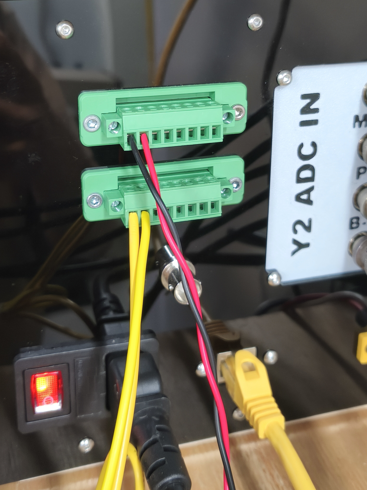

# Cathode control

The cathode is a hot filament on a Kikusui PWR401L supply (PWR-01 series,
0–40 V, 0–40 A). The supply's output current follows a voltage on its
external current-control input, pins 11 (+) and 15 (−) of the rear J1
connector, and that voltage comes from the control unit's 12-bit MCP4725
DAC through an isolation stage. The program drives the cathode two ways;
either is chosen on the rig's **Cathode** dock or on the web Control tab's
Cathode group, and setting one turns the other off.

## Connect the correct green plugs

On the present ControlUnit enclosure, viewed as in the photo below:

- **Top green port: Kikusui cathode control**, the red/black wire pair.
- **Bottom green port: MFCs**, the yellow wires in the green plug.

Set cathode and gas drives to zero and switch the PSU output off before
reconnecting. Check both the cable and its destination after moving or
servicing the box; the similar green plugs are not interchangeable.

PIHTI Log, 2026-09-30, 17:35–17:50: the Kikusui control cable had been left
unplugged after work on the box. The owner then recorded the correct port
assignment above and a successful plasma run. At 17:50, a 1800 mV cathode
command accompanied measured PSU output of 6.8621 V / 15.5079 A.

The LAN Output indicator reports the PSU's output-enable state; it does
not prove that the analog control cable is connected or that power is
flowing. Likewise, the cathode drive value is a software command, not a
measurement at J1. Check the physical connection before diagnosing an
enabled PSU with near-zero measured output as a webserver or supply fault.

## PID

A plasma current in amperes (0–3 A). The plasma current PID, which runs
inside the ADC reader thread, moves the DAC every sample to hold the
measured `Ip` at the setpoint. There are two ways off on the web's
Cathode card (4.30.0): **Hold** turns the PID off and keeps the cathode at
the loop's present drive, handing it to Manual; **Off** drops the DAC to
zero, as "PID off" always did (its old label did not say so, and on
2026-11-13 it put out two discharges the loop had just brought to 1.5 A).

Because the loop runs in the reader, it stops moving when the reader
stops. From 4.11.0 the reader retries a failed read instead of dying, and
the main thread writes "Reader lost" to the log if samples stop anyway;
before that, a dead reader meant "PID on" moved nothing, which read at the
rig as the supply not answering (2026-09-09).

## Manual

A voltage in millivolts (0–5000) held on the DAC with the PID off — the
knob, in software (owner direction 2026-09-09). The filament sits where a
person put it whatever the plasma does, and the drive is written from the
main thread straight to the DAC worker, so it works while the reader is
lost. The web Control tab offers ±1000/100/10/1 mV draft steps and a Set,
as the gas rows do. The log line is "Cathode drive set to N mV, PID off",
and the web record's `cathode_mv` carries what the DAC holds, whichever
mode put it there; `/api/health` says `outputs live: cathode drive` while
it is not zero.

Until 4.11.0 this row was the Settings dock's "Output voltage" in volts,
on the rig's screen only.

## Ip with the filament off

Plasma current needs a hot filament. queezz, 2026-11-13: "if we see the
current with the filament power off, it's a SUS. So we should warn, really.
Sometimes the current sensor gets a wrong zero". With the cathode drive at
0 mV, `Ip_c` sits at −0.005 to −0.016 A from 2026-10-22 to 11-13, drifting
slowly: that is the Hall sensor's zero. Exactly one stretch of more than
3 s had the drive at 0 and Ip above 0.1 A: 15:25 on 2026-11-13, 27 s at a
flat 2.38 A after the discharge had gone out, then −0.02 A. Its cause is
not known — a sensor whose zero moved, or current through the preanode
circuit — but it was not plasma current (vault note "Student runs audit
2026-10-22 to 11-13").

The program now says so in the Log when it happens
(`controlunit/filament_off.py`, judged on the main thread from each
delivered batch):

- **Filament off** is the Kikusui's own measurement while its telemetry is
  fresh: under 1 A, or its output off. Without fresh telemetry it is the
  row's own cathode drive at 0 mV. A drive of 0 mV with the supply
  measuring 18 A is the filament run on the supply's own knob (CF10 off,
  below), and its plasma current is plasma current: no warning.
- **Ip** is as the PID sees it, after the Ip zero; a NaN never counts. It
  counts above the PID's own lit threshold, `Lit Above A` in settings.yml
  (0.1 A).
- **Three seconds** on the rows' own clock, continuously: a discharge whose
  drive went to zero is gone within a second or two, and is not warned
  about. At 10 s sampling two rows in a row are enough.

Then one red line, once:

> Ip reads 2.38 A with the filament off (cathode drive 0 mV): not plasma
> current. If the preanode supply's panel shows no current, the sensor's
> zero is off (Zero Ip with everything off); if it shows current, something
> conducts with the filament off.

The parenthesis says how the filament was known to be off (`cathode drive
0 mV`, `the supply's output off`, `the supply at 0.40 A`). One plain line
when it ends — "Ip no longer reads current with the filament off, after
27 s at up to 2.38 A" — or, if the run is stopped first, "Acquisition
stopped while Ip still read current with the filament off, …". Nothing is
zeroed or driven: Zero Ip is a person's press, made with everything off.

## The supply's own knob

The Kikusui obeys its external input only while its CONFIG parameter
**CF10 (Ext. CC)** is ON; with CF10 OFF the front-panel CURRENT knob sets
the current again, whatever the DAC holds. So to run the cathode by hand
with the Raspberry Pi out of the loop: turn the drive off in the program
(or stop acquisition), then on the supply press CONFIG, turn the VOLTAGE
knob to `CF10`, turn the CURRENT knob to `OFF`, and hold CONFIG until the
measured values return. The change applies at once. CF11 is the same
switch for voltage control and CF12 the input range (`Lo`, 0–5 V, the
factory setting: output current = 40 A × Vext / 5 V at the
supply's own input). Set CF10 back to ON to hand control to the program
again. The manual pages are scans in the lab vault under
`Hardware/Equipment/Kikusui Power Supplies.md`, and the lab's own page is
[aklab-howto](https://queezz.github.io/aklab-howto/hardware/equipment/kikusui-pwr/).

## Logging its voltage and current

From 4.15.0, optional read-only LAN logging writes the supply's measured
voltage/current to a separate timestamped file beside each acquisition.
Manual drive and PID behaviour are unchanged. The old ADC `Ci/Cv` values
are not LAN measurements. Setup, file fields and the loss-of-connection
behaviour are described in [Kikusui over LAN](kikusui-lan.md).
